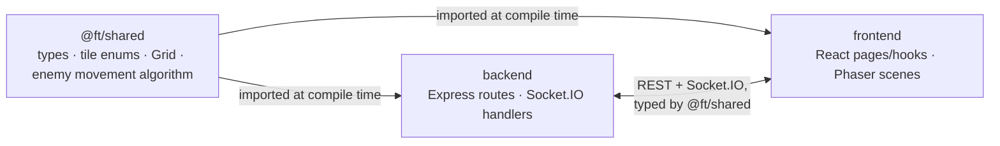
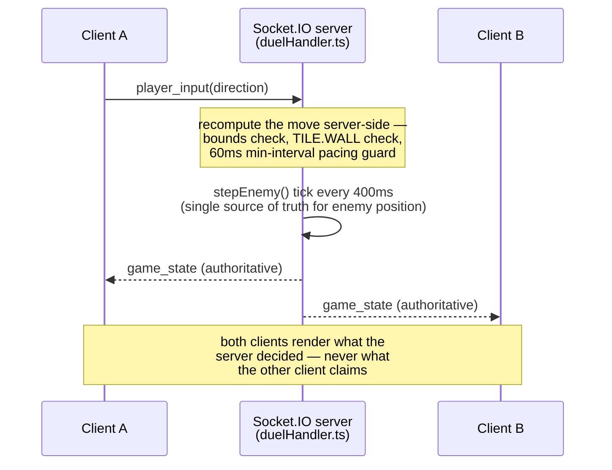
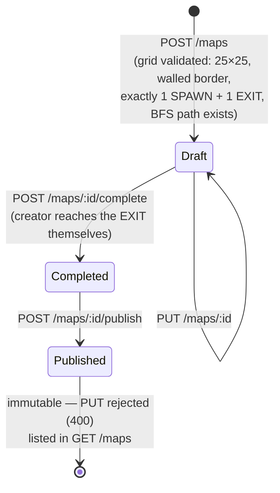
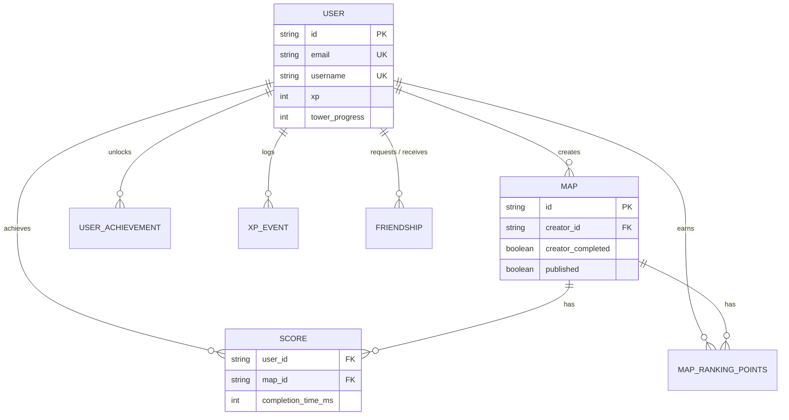
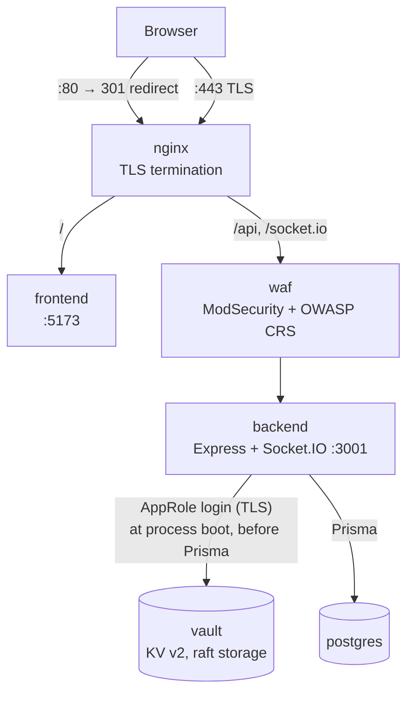
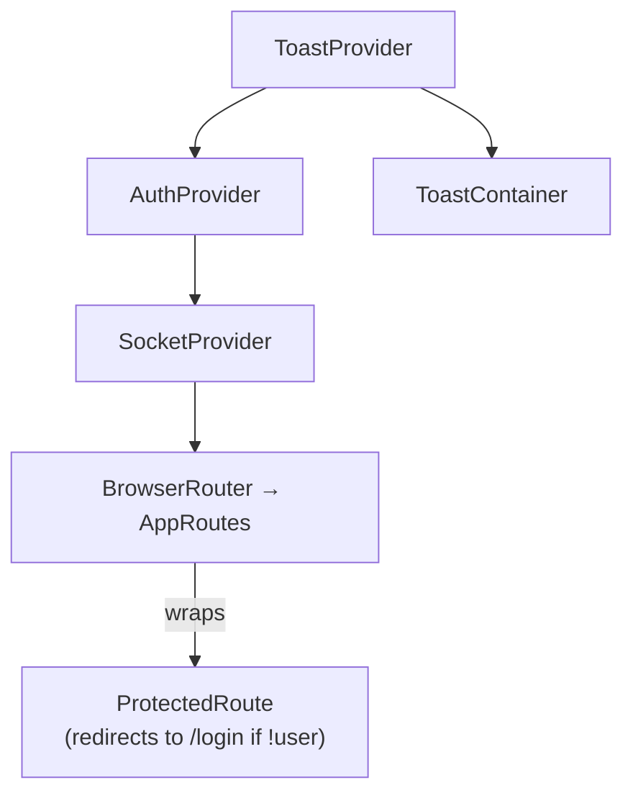

# Architecture — Design Highlights

## Purpose of this document

[docs/architecture.md](../architecture.md) is the canonical *folder reference* — what lives where. This document is different: it walks through the handful of architectural decisions that hold the codebase together, explains *why* each one was made, and shows the mechanism with a diagram. It's meant to be the fast way to answer "is this actually well designed, or did it just happen to work?" during a code review or a defense.

Five decisions do most of the work:

1. A single shared TypeScript package makes the frontend/backend contract impossible to drift silently.
2. The Socket.IO layer is server-authoritative by construction, not by convention.
3. The map lifecycle is a small explicit state machine backed by a real graph-reachability check, not a "trust the client" flag.
4. The database schema encodes its own integrity constraints (cascades, composite uniqueness) instead of relying on application code to remember them.
5. Infrastructure security (WAF + secrets) is a separate concern from application code — the backend never sees a raw secret it wasn't handed at boot.

## 1. One shared package, not two codebases that happen to agree

The risk in any client/server app is two independent type definitions for the same wire payload quietly diverging — a field renamed on the server becomes a silent `undefined` on the client. `shared/src` removes that risk structurally: `ClientToServerEvents`, `ServerToClientEvents`, `GameState`, `Grid`, and the tile enum are defined once and imported by both sides (`backend/src/server.ts` types its Socket.IO server as `Server<ClientToServerEvents, ServerToClientEvents>`; the frontend hooks consume the same types). A mismatched event name or payload shape is a **compile error**, not a bug report.

The same package also holds `shared/src/game/enemyLogic.ts` — the deterministic enemy-bounce algorithm. That one is worth calling out specifically: it used to be duplicated (client prediction in solo mode, a second implementation for the multiplayer server), and a real bug came from exactly that duplication drifting apart (`docs/backend_doc/duel-server-authoritative-enemies.md`). Moving it into `shared/` doesn't just avoid *future* drift, it's the fix for a drift bug that already happened — a case of the architecture directly encoding a lesson learned.

## 2. Server-authoritative real-time — the server is asked, never told

Duel races could have been built the easy way: each client simulates its own enemies and reports its own outcome. That's also the version that's easy to cheat and easy to desync. Instead, `backend/src/socket/duelHandler.ts` treats every client message as a *request to be validated*, never as a fact:

Two details make this more than a slogan:

- **Pacing is enforced server-side, not just client-side.** `MIN_INPUT_INTERVAL_MS = 60` in `duelHandler.ts` rejects `player_input` events faster than any real tween could produce — specifically closing off a scripted `socket.emit` loop that bypasses the client's own animation pacing (documented in `history_debug/2026-08-14_faille-scores-forgeable.md`).
- **Collision is checked from both directions.** A player's move and an enemy's tick can each cause a collision, so both paths check it — a subtle bug (fixed and documented in `docs/backend_doc/duel-server-authoritative-enemies.md`) came from checking only one direction, which let a player walk *through* an enemy that had just vacated a tile without ever being caught.

The payoff: two browsers on two different networks always converge on the same outcome, because there's only ever one place the outcome is decided.

## 3. The map lifecycle is a state machine, not a boolean you hope stays consistent

Two guarantees fall directly out of this design, not out of documentation someone has to remember to follow:

- **A published map is guaranteed completable.** `backend/src/utils/grid.utils.ts#hasPath` runs a real BFS from `SPAWN` to `EXIT` at creation time, and publishing is additionally gated on `creator_completed` — the creator must have actually reached the exit through gameplay, not just passed structural validation. Two independent checks (graph reachability *and* a real playthrough) instead of trusting either alone.
- **A published map can't shift under active players.** `PUT /maps/:id` is rejected with 400 once `published === true`. This isn't incidental — `Score` rows are foreign-keyed to a specific `Map`, so a silently-edited grid after publication would invalidate every existing leaderboard entry for it (`docs/backend_doc/cycle-de-vie-map.md`).

## 4. The database schema enforces its own invariants

A few choices here are doing more work than they look like:

- `Score` is `@@unique([user_id, map_id])` — the schema itself makes "one best time per player per map" impossible to violate, instead of relying on application code to `findFirst` before every insert. `scoring.service.ts#upsertBestScore` reads as a straightforward upsert precisely because the schema already rules out the duplicate-row case.
- Every foreign key that should cascade does (`onDelete: Cascade` on `Map.creator`, `Friendship`'s two named relations, `UserAchievement`, `XpEvent`, `MapRankingPoints`) — deleting a user or a map cleans up its dependents automatically, with one deliberate exception (`Score.user` has no cascade), so account/map deletion never leaves orphaned rows to reason about later.
- `MapRankingPoints` and `Score` both carry composite indices matched to their actual hot query (`@@index([map_id, completion_time_ms])`, `@@index([map_id, user_id])`) — the leaderboard queries that read "top 5 by completion time for this map" aren't doing a full table scan.
- `Friendship` uses two distinctly-named relations (`FriendshipRequester`/`FriendshipAddressee`) on the same `User` model rather than a generic many-to-many join table — the schema itself preserves *who requested whom*, which the friends UI and any future "pending request" feature needs.

## 5. Infrastructure security is layered, and secrets never touch disk

The interesting part isn't "there's a WAF" — it's what the backend process is trusted with. `backend/src/bootstrap.ts` runs before `server.ts` is even imported: in Docker, it exchanges narrowly-scoped `VAULT_ROLE_ID`/`VAULT_SECRET_ID` AppRole credentials for a short-lived Vault token, reads exactly one KV path it has read-only access to, and injects `DATABASE_URL`/`JWT_SECRET` into `process.env` — in memory only. The backend container never holds the actual database password or JWT signing key on disk; if the AppRole credentials themselves leaked, Vault's policy limits the blast radius to one path, and the token expires in at most 4 hours (`token_max_ttl`). In local (non-Docker) development, the exact same `bootstrap.ts` code path falls back to `backend/.env` — one code path handles both environments, so there's no separate "dev-only secrets" mechanism to keep in sync or accidentally ship. Full detail in [docs/major_modules/waf-vault-security/README.md](../major_modules/waf-vault-security/README.md).

## 6. The frontend composes cross-cutting concerns as providers, not scattered checks

`App.tsx` nests exactly the providers that are genuinely global (toast feedback, auth session, the Socket.IO connection) and stops there — game-specific state lives in Phaser scenes, not in a context; page-specific state lives in the page. `ProtectedRoute` is a single ~10-line component reused on every authenticated route instead of a per-page auth check copy-pasted (or forgotten) — `/profile`, `/editor`, `/tower`, `/duel`, and every `/play/*` route all go through the same gate. `ToastContainer` is deliberately mounted once at the `App` level, outside `Layout` — a real bug (documented in `frontend/src/__tests__/LoginPage.toast.test.tsx`'s own header comment) came from a toast provider that only worked on pages wrapped in `<Layout>`, silently swallowing feedback on `LoginPage`, which isn't.

## 7. Tests are structured around the same architecture, not bolted on after

The test suite (full write-up: [docs/testing/README.md](../testing/README.md)) mirrors the boundaries above rather than fighting them: backend tests mock `../lib/prisma` at the module level so route logic is exercised through a *real* Express app and a *real* JWT, with Prisma as the only stub; frontend tests mock exactly the hooks/services a page depends on so Phaser and real HTTP never need to boot for a page-logic test. That's only possible because the boundaries (routes vs. Prisma, pages vs. hooks/services) are real seams in the architecture, not something the tests have to work around.

## Summary

| Decision | What it prevents |
|---|---|
| One `@ft/shared` package for every contract | Silent frontend/backend payload drift |
| Server-authoritative movement + enemy tick | Cheating, cross-client desync, unfair collisions |
| Map lifecycle state machine + BFS validation | Publishing an unplayable or later-edited map |
| Schema-level uniqueness, cascades, indices | Duplicate scores, orphaned rows, slow leaderboards |
| Vault AppRole + narrow policy, secrets in memory only | Plaintext credentials on disk or in the image |
| Provider composition + one `ProtectedRoute` | Per-page auth checks drifting out of sync |
| Tests mocked at real architectural seams | Tests that pass without actually exercising the logic |
