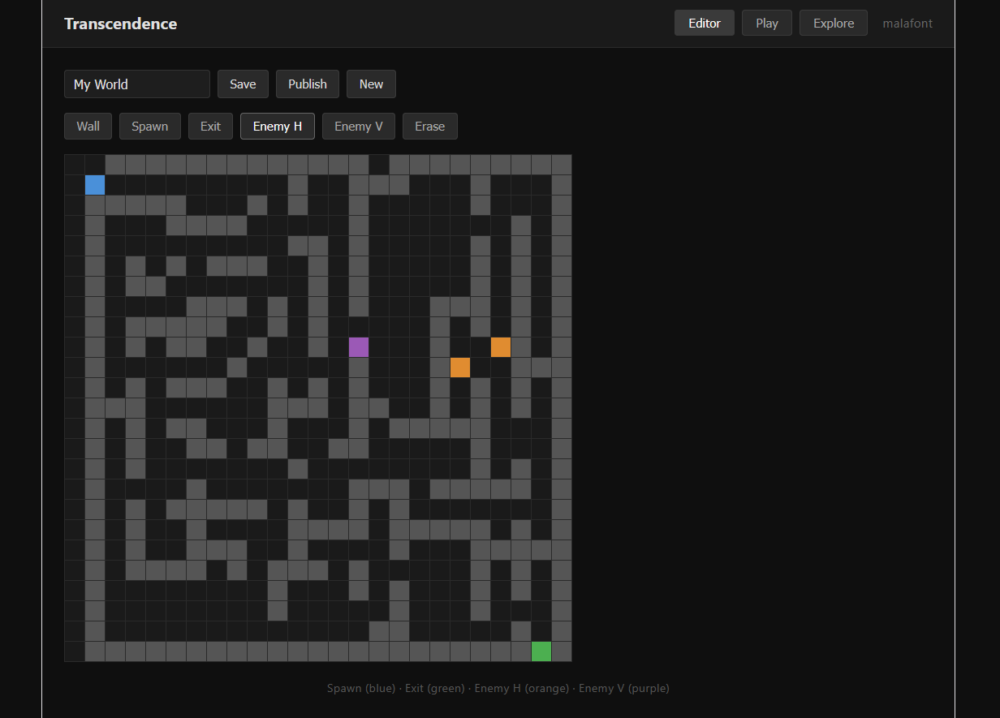
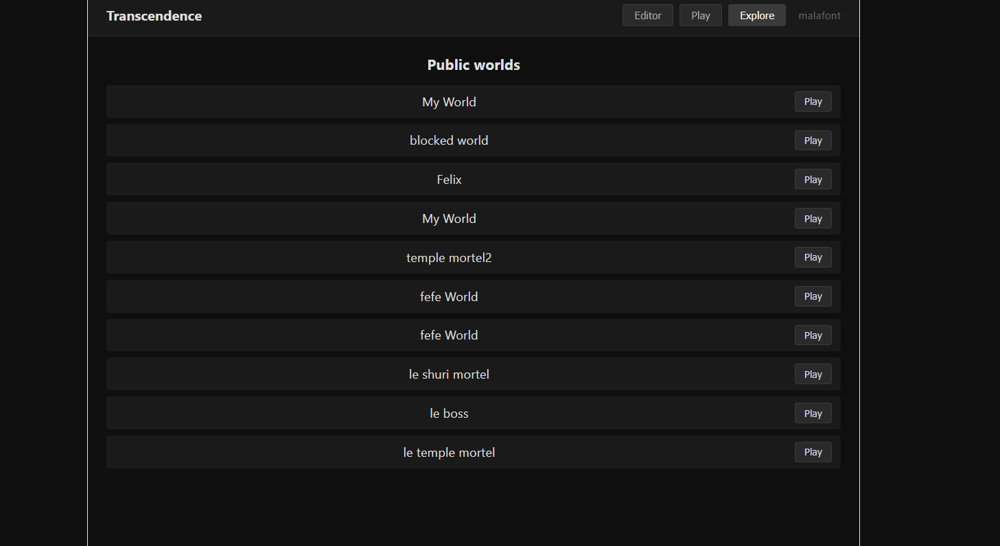

# ft_transcendence — Présentation MVP

## Contexte

Premier livrable du projet ft_transcendence (42 School).  
Le MVP valide la boucle complète : un utilisateur peut créer une carte, la tester, la compléter, puis la publier pour que d'autres joueurs puissent y jouer.

---

## Stack technique

| Couche | Technologie |
|--------|-------------|
| Frontend | React 19 + Vite |
| Backend | Node.js + Express |
| Base de données | SQLite (better-sqlite3) |
| Auth | JWT (7 jours) + bcrypt |

---

## Fonctionnalités implémentées

### Authentification

- Inscription et connexion par nom d'utilisateur + mot de passe
- Token JWT stocké côté client, restauration de session automatique au rechargement

---

### 1. Création de carte — onglet Editor

L'éditeur permet de dessiner une carte 25×25 cellule par cellule.

**Outils disponibles :**

| Outil | Couleur | Rôle |
|-------|---------|------|
| Wall | Gris | Mur impassable |
| Spawn | Bleu | Point de départ du joueur (un seul) |
| Exit | Vert | Sortie / objectif (un seul) |
| Enemy H | Orange | Ennemi qui se déplace horizontalement |
| Enemy V | Violet | Ennemi qui se déplace verticalement |
| Erase | — | Efface une cellule |

Le peinture est continue : maintenir le clic et faire glisser peint plusieurs cellules d'un coup.  
Un nom de carte peut être saisi avant la sauvegarde.

> **Règle de validation :** la carte doit contenir au moins un Spawn et un Exit avant de pouvoir être sauvegardée.



---

### 2. Test de la carte — onglet Play

Le joueur contrôle son personnage (rouge) avec les touches fléchées.

- Les ennemis se déplacent automatiquement (toutes les 400 ms)
- Toucher un ennemi → Game Over
- Atteindre la sortie verte → Victoire

> **Condition de publication :** le créateur doit lui-même terminer sa carte dans l'onglet Play. Cela valide que la carte est jouable et franchissable.  
> Une fois complétée, le badge "Completed — can publish" s'affiche dans l'éditeur.


---

### 3. Publication — bouton Publish

Une fois la carte complétée par son créateur, le bouton **Publish** la rend visible dans l'onglet Explore de tous les utilisateurs.

Conditions requises avant publication :
1. Carte sauvegardée
2. Spawn et Exit présents
3. Créateur a terminé sa propre carte


---

### 4. Explorer les cartes publiques — onglet Explore

Liste toutes les cartes publiées par la communauté.  
Un clic sur **Play** charge la carte directement en mode jeu.



---

## Architecture — flux de données

```
[Navigateur]
    │
    ├── AuthForm          → POST /auth/register | /auth/login
    │                        ← { token, user }
    │
    └── MapEditor
         ├── Editor tab   → POST /maps           (créer)
         │                → PUT  /maps/:id        (modifier)
         │
         ├── Play tab     → POST /maps/:id/complete  (débloquer publication)
         │
         ├── Publish btn  → POST /maps/:id/publish
         │
         └── Explore tab  → GET  /maps            (cartes publiques)
                          → GET  /maps/:id         (charger une carte)
```

---

## Prochaines étapes (backlog)

- [ ] Multijoueur temps réel (WebSockets)
- [ ] Profils utilisateurs + avatars
- [ ] Docker + HTTPS
- [ ] Sprites et animations du joueur
- [ ] Validation des formulaires (frontend + backend)
- [ ] Politique de confidentialité + CGU (exigence du sujet)
